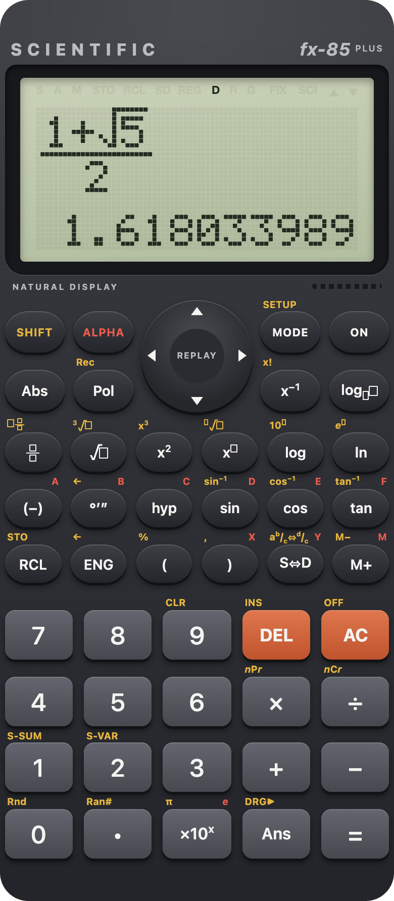

# fx-85 PLUS calculator for mobile usage

Here is my own, everyday calcualtor app to use on mobile. 

I made it because, the built-in calculator apps don't have the intuitive Casio design, known from school and the third-party alternatives are full of ads.

**Available at:** https://mobile-calculator.netlify.app/

**Usage:** Add the website as a shortcut widget in your (android) phone. It will work like an app also offline, once it's loaded.

## More

Features, local development, deployment and code layout are in [docs/DEVELOPMENT.md](docs/DEVELOPMENT.md).
